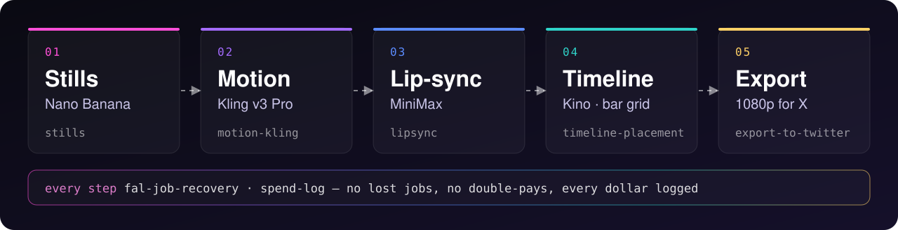

<p align="center">
  
</p>

<p align="center">
  <a href="LICENSE"></a>
  
  
  
</p>

<p align="center">
  <b>Turn your coding agent into a video production crew.</b><br>
  Skills and playbooks that give Claude Code, Codex and friends one locked, repeatable way to make AI video from images.
</p>

<p align="center">
  <a href="#-quick-start">Quick start</a> ·
  <a href="#-the-pipeline">The pipeline</a> ·
  <a href="#-skills">Skills</a> ·
  <a href="#-create-a-video">Create a video</a>
</p>

---

## ✨ Why

Every new agent session picks different models, different prompts and a different process, so your shots drift and your bill creeps up. **ai-video-agent** fixes the workflow in place:

- 🎬 **Same look, every session.** One stills model and one motion model, with locked settings and prompt patterns.
- 💸 **Every dollar logged.** Prices are quoted before each batch and every run is recorded in the video's `ROADMAP.md`.
- 🛟 **No lost or double-paid jobs.** Timeouts and interrupts resume the job instead of paying for it twice.
- 🎵 **Cut to the music.** Clips land on the bar grid, and lip-sync shots are measured, not eyeballed.

Built around [Kino](https://kino.ai) (editor + MCP tools) and [fal](https://fal.ai) (generation).

## 🎞 The pipeline

<p align="center">
  
</p>

## 🚀 Quick start

```bash
git clone https://github.com/musashi-glitch/ai-video-agent ~/code/ai-video-agent
cd ~/code/ai-video-agent && ./install.sh
```

`install.sh` symlinks each skill into `~/.agents/skills/` and `~/.claude/skills/`, so a `git pull` updates every agent at once. Existing skills with the same name are moved to `*.bak-<timestamp>`, never deleted.

Then tell your agent:

> *"Use the video-pipeline skill for projects/my-video."*

**You'll need:** Kino desktop with its MCP server connected to your agent, fal access (through Kino's `fal` tool), and `ffmpeg`/`ffprobe`, `python3` and `bash`.

## 🧰 Skills

| | Skill | What it does |
|---|---|---|
| 🧭 | [`video-pipeline`](skills/video-pipeline/SKILL.md) | **Start here.** Session start, per-section workflow, hard rules |
| 🖼 | [`stills`](skills/stills/SKILL.md) | Start frames, character sheets and swaps (Nano Banana) |
| 🎥 | [`motion-kling`](skills/motion-kling/SKILL.md) | Animate stills (Kling v3 Pro): prompt pattern, camera moves, negatives |
| 🎤 | [`lipsync`](skills/lipsync/SKILL.md) | Singing and talking shots (MiniMax): audio slices, sync check |
| ✂️ | [`timeline-placement`](skills/timeline-placement/SKILL.md) | Place, swap, trim, retime and mute clips in Kino |
| 📤 | [`export-to-twitter`](skills/export-to-twitter/SKILL.md) | The highest-quality file X/Twitter accepts |
| 🛟 | [`fal-job-recovery`](skills/fal-job-recovery/SKILL.md) | Survive timeouts and interrupts without losing or re-paying jobs |
| 💸 | [`spend-log`](skills/spend-log/SKILL.md) | ROADMAP spend and asset log format |

Plus [`playbooks/`](playbooks) for [models](playbooks/models.md), [prompt patterns](playbooks/prompt-patterns.md) and [camera moves](playbooks/camera-moves.md), and [`tools/`](tools) for a lip-sync lag checker.

## 🎬 Create a video

```bash
cp -R projects/_example projects/my-video
```

```
projects/my-video/
├── BIBLE.md      style block, cast, set, rules, paths, budget
├── SHOTLIST.md   the plan, against the bar grid
├── CUTLIST.md    what's on the timeline now
├── ROADMAP.md    spend log, pending jobs, asset IDs, exports
└── prompts.md    exact prompts of approved takes
```

Fill in `BIBLE.md` first. Your video stays on your machine: everything under `projects/` except `_example` is gitignored, and so are media files and `stills/ slices/ backups/ versions/ renders/` anywhere in the repo.

## 🤝 Contributing

Keep skills generic: no project names, media IDs or likenesses. When a session learns something that will hold up (a model setting, a camera lesson), add it to the matching skill or playbook. See [`AGENTS.md`](AGENTS.md) for the conventions.

## 📄 License

[MIT](LICENSE)
